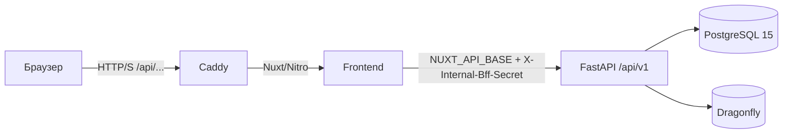

# Classifyd

**Classifyd** — некастодиальная P2P-площадка объявлений с оплатой в USDT. В целевой архитектуре сделки защищаются смарт-контрактом эскроу, а их результат фиксируется NFT Deal Certificate. Доступ к площадке выполняется через кошелек по стандарту SIWE (Sign-In with Ethereum), без пароля, email и KYC.

## Текущее состояние

Реализованы:

- Nuxt 4 / Vue 3 интерфейс и Nitro BFF-слой;
- FastAPI backend с синхронным SQLAlchemy 2.x;
- PostgreSQL 15 для данных и Dragonfly для nonce и серверных сессий;
- модель пользователя с UUIDv7, уникальным адресом кошелька и реферальной связью;
- stateful SIWE-авторизация: `nonce`, `verify`, `me`, `logout`;
- подписанная `HttpOnly; Secure; SameSite=Strict` cookie с идентификатором сессии;
- защита внутреннего FastAPI API заголовком `X-Internal-Bff-Secret`;
- начальная Alembic-миграция таблицы `users`.

JWT и токены сессий не сохраняются в `localStorage`. Смарт-контракты эскроу, NFT-сертификаты и Seller Passport относятся к следующим этапам; их запуск не требуется для текущего backend/BFF API. Подключение кошелька в браузерном UI является отдельной задачей.

## Архитектура



- **Браузер** обращается только к публичным `/api/...` маршрутам Nitro BFF.
- **Nitro BFF** передает запросы во внутренний FastAPI и управляет cookie сессии.
- **FastAPI** содержит бизнес-логику и проверяет внутренний BFF-секрет.
- **PostgreSQL** хранит пользователей; **Dragonfly** — одноразовые nonce и активные сессии.
- В production-конфигурации наружу публикуются только порты Caddy `80` и `443`.

Подробнее об устройстве проекта: [ARCHITECTURE_MAP.md](./ARCHITECTURE_MAP.md).

## Требования

- Docker с Docker Compose v2 (`docker compose`, а не старый `docker-compose`);
- свободные порты `80` и `443` для production-варианта;
- свободный порт `3000` для dev-варианта;
- для локального варианта дополнительно порты `8000` и `24678`.

Проверка установки:

```bash
docker --version
docker compose version
```

Все команды ниже выполняются из корня репозитория.

## Настройка окружения

Создайте `.env` из безопасного шаблона:

```bash
cp .env.example .env
```

Обязательно замените в `.env` все значения-заглушки, особенно:

| Переменная | Назначение |
| --- | --- |
| `POSTGRES_PASSWORD` | Пароль PostgreSQL |
| `SECRET_KEY` | Подпись значения session cookie, минимум 32 символа |
| `INTERNAL_BFF_SECRET` | Общий секрет Nitro BFF и FastAPI, минимум 32 символа |
| `EVM_RPC_URL` | RPC endpoint EVM-сети; обязателен для конфигурации, но проверка SIWE-подписи выполняется локально |
| `SIWE_DOMAIN` | Точный домен из SIWE-сообщения, без схемы и порта |
| `SIWE_URI` | Полный origin приложения, включая схему и нестандартный порт |
| `EVM_CHAIN_ID` | Chain ID сети; в шаблоне `42161` (Arbitrum One) |

Сгенерировать независимые секреты можно так:

```bash
openssl rand -hex 32
```

Для dev/local на `http://localhost:3000` используйте:

```dotenv
SIWE_DOMAIN=localhost
SIWE_URI=http://localhost:3000
```

Для production на `https://example.com`:

```dotenv
SIWE_DOMAIN=example.com
SIWE_URI=https://example.com
```

Compose сам задает `REDIS_URL` для backend: `redis://classifyd_cache:6379` в production-варианте и `redis://classifyd_dev_cache:6379` в dev/local. Это адреса Dragonfly внутри Docker-сети; не заменяйте их на `localhost` внутри контейнеров.

> **Важно:** `.env` содержит секреты и не должен попадать в Git. Не используйте одинаковые пароли, секреты или базы данных для production и разработки.

## Вариант 1: production-like окружение

Файл: [docker-compose.yml](./docker-compose.yml).

Запускаются PostgreSQL, Dragonfly, FastAPI, production-сборка Nuxt и Caddy. Backend работает через Uvicorn с двумя workers. PostgreSQL, Dragonfly, backend и frontend доступны только внутри Docker-сети; снаружи опубликованы порты Caddy `80` и `443`.

### Запуск

```bash
docker compose --env-file .env -f docker-compose.yml up -d --build
```

Дождитесь готовности PostgreSQL и примените миграции:

```bash
docker compose --env-file .env -f docker-compose.yml exec backend alembic upgrade head
```

Проверка:

```bash
docker compose --env-file .env -f docker-compose.yml ps
curl --fail --output /dev/null http://localhost/
```

Основной адрес: **http://localhost**. Браузерная авторизация использует BFF-маршруты `/api/auth/...`. FastAPI не опубликован на host: Caddy проксирует к нему только `/api/uploads/...`, а остальные запросы направляет в Nuxt.

### Логи и остановка

```bash
docker compose --env-file .env -f docker-compose.yml logs -f --tail=100
docker compose --env-file .env -f docker-compose.yml down
```

Для production необходимо настроить реальный домен, HTTPS в Caddy и соответствующие `SIWE_DOMAIN`/`SIWE_URI`. Текущий [Caddyfile](./Caddyfile) содержит локальные HTTP-маршруты и не является готовой HTTPS-конфигурацией публичного домена.

## Вариант 2: dev/staging-окружение

Файл: [docker-compose.dev.yml](./docker-compose.dev.yml).

Это изолированный Compose-проект `classifyd-dev` с отдельными сервисами `dev_postgres`, `dev_dragonfly`, `dev_backend`, `dev_frontend` и отдельными томами. Frontend собирается в production-режиме; hot reload в этом варианте нет. Caddy этот файл не запускает.

### Запуск

Создайте общую внешнюю сеть, если она еще не существует:

```bash
docker network inspect classifyd_network >/dev/null 2>&1 || docker network create classifyd_network
```

Запустите сервисы и примените миграции:

```bash
docker compose --env-file .env -f docker-compose.dev.yml up -d --build
docker compose --env-file .env -f docker-compose.dev.yml exec dev_backend alembic upgrade head
```

Проверка:

```bash
docker compose --env-file .env -f docker-compose.dev.yml ps
curl --fail --output /dev/null http://localhost:3000/
```

Основной адрес: **http://localhost:3000**.

Адрес `http://dev.localhost` доступен только при одновременно запущенном Caddy из production-конфигурации в общей сети `classifyd_network`. Для этого маршрута в [Caddyfile](./Caddyfile) включена Basic Auth; используйте учетные данные, настроенные владельцем окружения.

### Логи и остановка

```bash
docker compose --env-file .env -f docker-compose.dev.yml logs -f --tail=100
docker compose --env-file .env -f docker-compose.dev.yml down
```

## Вариант 3: локальная разработка с hot reload frontend

Файлы: [docker-compose.dev.yml](./docker-compose.dev.yml) + [docker-compose.local.yml](./docker-compose.local.yml).

Override-файл:

- монтирует `./frontend` в контейнер;
- запускает `npm run dev` с Nuxt/Vite hot reload;
- публикует frontend на `3000`, backend на `8000` и Vite HMR на `24678`;
- сохраняет `node_modules` и `.nuxt` в отдельных Docker-томах.

Backend остается на обычной команде Uvicorn без `--reload`: после изменения Python-кода перезапустите `dev_backend` или пересоберите сервис.

### Запуск

```bash
docker network inspect classifyd_network >/dev/null 2>&1 || docker network create classifyd_network
docker compose --env-file .env \
  -f docker-compose.dev.yml \
  -f docker-compose.local.yml \
  up -d --build
docker compose --env-file .env \
  -f docker-compose.dev.yml \
  -f docker-compose.local.yml \
  exec dev_backend alembic upgrade head
```

Проверка:

```bash
curl --fail --output /dev/null http://localhost:3000/
curl --fail http://localhost:8000/health
```

Адреса:

- приложение: **http://localhost:3000**;
- FastAPI health: **http://localhost:8000/health**;
- OpenAPI: **http://localhost:8000/docs**.

### Перезапуск backend и остановка

```bash
docker compose --env-file .env \
  -f docker-compose.dev.yml \
  -f docker-compose.local.yml \
  restart dev_backend

docker compose --env-file .env \
  -f docker-compose.dev.yml \
  -f docker-compose.local.yml \
  down
```

## Миграции и пересборка

Миграции не выполняются автоматически при `up`. После первого запуска и появления новых миграций выполните `alembic upgrade head` в соответствующем backend-контейнере:

```bash
# production-like
docker compose --env-file .env -f docker-compose.yml exec backend alembic upgrade head

# dev/local
docker compose --env-file .env -f docker-compose.dev.yml exec dev_backend alembic upgrade head
```

После изменения зависимостей или Dockerfile пересоберите нужный вариант:

```bash
docker compose --env-file .env -f docker-compose.dev.yml up -d --build
```

Для local-варианта при пересборке также передавайте оба `-f` файла.

## Проверка API авторизации

Браузер использует следующие Nitro BFF-маршруты:

| Метод | Маршрут | Назначение |
| --- | --- | --- |
| `POST` | `/api/auth/nonce` | Получить SIWE-сообщение и nonce с TTL 5 минут |
| `POST` | `/api/auth/verify` | Проверить подпись, создать/найти пользователя и установить cookie |
| `GET` | `/api/auth/me` | Получить профиль по серверной сессии |
| `POST` | `/api/auth/logout` | Удалить сессию и очистить cookie |

Пример получения nonce в dev/local:

```bash
curl -i http://localhost:3000/api/auth/nonce \
  -H 'Content-Type: application/json' \
  --data '{"wallet_address":"0x0000000000000000000000000000000000000001"}'
```

Для `verify` нужна реальная подпись возвращенного SIWE-сообщения приватным ключом соответствующего кошелька. Подпись можно создать, например, через `eth-account`; подставлять произвольную строку вместо подписи нельзя. После успешного `verify` сохраняйте cookie и передавайте ее в `me`/`logout` с помощью `curl -c cookies.txt` и `curl -b cookies.txt`.

Прямые запросы к `/api/v1/...` требуют заголовок `X-Internal-Bff-Secret`. Не передавайте его браузерному JavaScript и не публикуйте в клиентском коде.

## HTTPS и Secure cookie

Session cookie всегда создается с атрибутом `Secure`. Поэтому реальные `verify`/`me`/`logout` следует проверять через HTTPS: браузер может не отправить такую cookie по обычному HTTP. Локальные HTTP-адреса удобны для проверки интерфейса, health и получения nonce, но не отключают требования безопасной авторизации.

Для полноценной локальной проверки входа настройте HTTPS-терминацию и согласуйте `SIWE_DOMAIN` и `SIWE_URI` с фактическим origin. Не ослабляйте `Secure`, `HttpOnly` или `SameSite=Strict` в общей конфигурации ради локального теста.

## Данные и очистка

Обычный `down` останавливает контейнеры, но сохраняет named volumes с данными. Команда `down -v` удаляет тома выбранного Compose-проекта, включая его базу данных:

```bash
docker compose --env-file .env -f docker-compose.dev.yml down -v
```

Используйте `-v` только для одноразового окружения, когда удаление данных действительно необходимо. Не запускайте тесты, seed или очистку против production-базы.

## Частые проблемы

- **`port is already allocated`** — остановите процесс, занимающий порт, или измените публикацию порта только в локальном override.
- **`network classifyd_network ... not found`** — создайте внешнюю сеть командой из dev/local-инструкции.
- **Backend не стартует из-за конфигурации** — проверьте `.env`, длину секретов и отсутствие значений-заглушек.
- **Ошибка подключения к БД/Dragonfly** — проверьте `ps`, `logs`, настройки `POSTGRES_*`/`REDIS_URL` и health контейнеров.
- **SIWE domain/URI mismatch** — домен, URI и chain ID в подписанном сообщении должны точно совпадать с backend-настройками.
- **Нет таблицы `users`** — выполните `alembic upgrade head` в работающем backend-контейнере.
